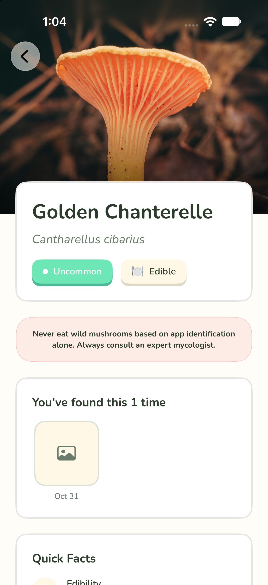
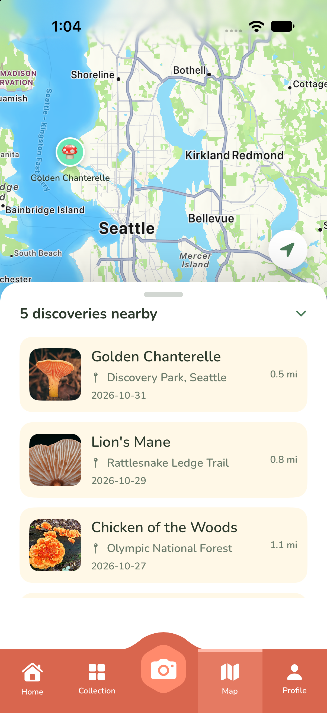

# ShroomScout 🍄

A Pokemon Go-style mushroom collection app for iOS. Scan mushrooms with your camera, pick the best identification match, and build a regional collection of your finds.

<p align="center">
  
  &nbsp;&nbsp;
  
</p>

## Features

- **Scanner:** Capture a mushroom photo and review suggested species matches
- **Collection:** Track discovered species by region, filter by rarity (Common, Uncommon, Rare, Legendary)
- **Species Detail:** Quick facts, edibility, lookalikes, and a history of your sightings
- **Map:** See your discoveries pinned on a map with a list of nearby finds
- **Profile:** Stats, progress, and settings
- **Onboarding:** Region selection, how it works, and a safety disclaimer

> ⚠️ Never eat wild mushrooms based on app identification alone. Always consult an expert mycologist.

## Tech Stack

| Area | Technology |
|------|------------|
| Platform | iOS 26+ (iPhone) |
| Language | Swift 6 |
| UI | SwiftUI |
| Persistence | SwiftData |
| Camera | AVFoundation, PhotosUI |
| Location & Maps | CoreLocation, MapKit |
| Architecture | MVVM |

## Getting Started

1. Clone the repo
2. Open `ShroomScout.xcodeproj` in Xcode 26 or later
3. Select an iOS 26 simulator or device
4. Build and run (⌘R)

## Project Structure

```
ShroomScout/
├── Models/          # SwiftData models (Species, Sighting, UserProfile, Region)
├── ViewModels/      # Home, Map, Profile, Scanner view models
├── Views/
│   ├── Components/  # Reusable UI (buttons, cards, badges, tab bar, mascot)
│   ├── Tabs/        # Home, Collection, Map, Profile
│   ├── Scanner/     # Camera, results, match detail, confirmation
│   ├── Species/     # Species detail and supporting cards
│   ├── Map/         # Clustered map and map components
│   └── Onboarding/  # First-run flow
├── Services/        # LocationService
└── Utilities/       # Color and font extensions
```

## Design System

- **Font:** Nunito (see `Font+App.swift`)
- **Colors:** Defined in `AppColors` (see `Color+App.swift`)
- **Components:** All reusable UI lives in `Views/Components/`

## Documentation

- [Implementation Plan](Docs/ShroomScout_Implementation_Plan.md)
